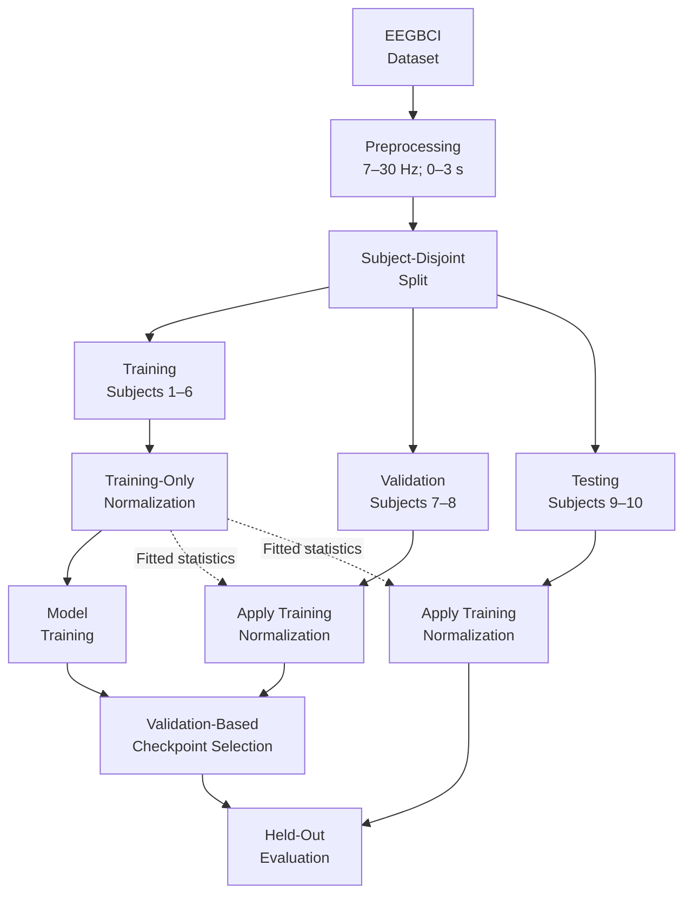
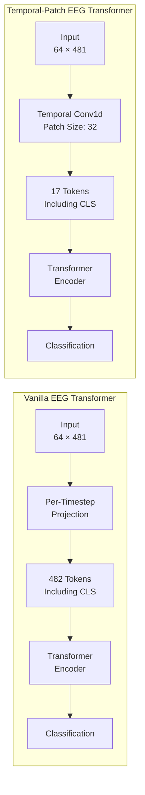

# Cross-Subject EEG Motor Imagery Classification

**Leakage-aware evaluation of EEGNet, full-sequence Transformers, and temporal-patch attention**

[](requirements-lock.txt) [](environment_actual.json) [](part2_transformer/comparison_summary.json) [](tests/test_integrity.py)

> **Principal finding:** A learned temporal-patch tokenizer reduces the attention sequence from **482 to 17 tokens**, with shorter recorded CPU runtimes than full-sequence attention. This computational advantage **did not translate into improved held-out classification accuracy**. All three evaluated architectures performed near chance on the two unseen test subjects.

**[Results](#results)** · **[Protocol](#experimental-protocol)** · **[Architectures](#model-architectures)** · **[Figures](#physiological-and-representation-analysis)** · **[Reproduce](#reproducibility)** · **[Scientific report](ANSWERS.md)**

---

## Research objective

Motor imagery EEG contains weak, spatially distributed mu- and beta-band signatures. Their expression varies across participants, making **cross-subject transfer** more demanding than classification within a single person's recordings.

This project has two connected components:

1. **Pipeline diagnosis:** correct six experimentally consequential defects in an EEGNet workflow; evaluate event-related desynchronization (ERD) and a possible visual-cue confound.
2. **Controlled model study:** compare an EEG-specific convolutional baseline, a vanilla timestep-token Transformer, and a Temporal-Patch EEG Transformer using fixed subject partitions and three random seeds.

The study prioritizes **subject-disjoint evaluation, explicit checkpoint selection, and reproducibility** over choosing the best observed seed.

### Study profile

| Property | Configuration |
|:--|:--|
| Dataset | [PhysioNet EEG Motor Movement/Imagery (EEGBCI)](https://physionet.org/content/eegmmidb/1.0.0/) |
| Binary task | Imagined **both fists** (`T1`, class 0) vs **both feet** (`T2`, class 1) |
| Acquisition | 64 channels, 160 Hz; imagery runs **6, 10, 14** |
| Part 2 input | 7–30 Hz, cue-aligned 0–3 s, **64 × 481** samples |
| Development split | Subjects **1–6 train**, **7–8 validate**, **9–10 test** |
| Trials | **270 / 90 / 90** for train / validation / test |
| Evaluation | Three architectures × seeds **0, 1, 2** = **nine completed runs** |
| Checkpoint selection | Earliest epoch achieving maximum **validation accuracy** |

## Results

### Held-out classification accuracy

The test subjects (9 and 10) were not used to fit normalization parameters, optimize model weights, or choose checkpoints.

| Architecture | Seed 0 | Seed 1 | Seed 2 | **Mean** | Population SD |
|:--|--:|--:|--:|--:|--:|
| EEGNet | 44.44% | 51.11% | 48.89% | **48.15%** | 2.77 pp |
| Vanilla EEG Transformer | 43.33% | 46.67% | 54.44% | **48.15%** | 4.66 pp |
| Temporal-Patch EEG Transformer (`YourModel`) | 46.67% | 45.56% | 50.00% | **47.41%** | 1.89 pp |

Balanced binary guessing has an expected accuracy of 50%. A majority-class predictor fixed on the training subjects scores **48.89%** on the test set. None of the neural models establishes a meaningful generalization advantage on these two unseen people.

Mean validation-selected accuracy was **68.15%** for EEGNet, **57.41%** for vanilla attention, and **64.81%** for temporal patches. The discrepancy between validation and test results suggests sensitivity to subject identity; with only two subjects in each group, it cannot isolate the underlying cause.

**Evidence:** [run-level records](part2_transformer/results.jsonl) · [computed comparison](part2_transformer/comparison_summary.json) · [scientific interpretation](ANSWERS.md)

### Architectural and computational comparison

| Metric | EEGNet | Vanilla Transformer | Temporal-Patch EEG Transformer |
|:--|--:|--:|--:|
| Parameters | **2,738** | 135,746 | 232,962 |
| Tokens including CLS | — | **482** | **17** |
| Attention-score entries per head and layer | — | 232,324 | 289 |
| Mean recorded CPU run duration | ~94 s | ~1,045 s | ~267 s |

Temporal patching uses approximately **804× fewer attention-score entries** (482²/17²). The recorded patch-model runs were approximately **3.9× shorter** than the vanilla runs. These durations are observational measurements from this experimental environment, **not controlled hardware benchmarks**. System load varied, and the five historical runs lacked the evaluation-mode training metrics added to the four later runs; the timing ratio therefore does not isolate an architectural speedup. The patch tokenizer also **increases parameter count**, so attention efficiency does not imply lower model capacity or better generalization.

Source: [training summary](part2_transformer/training_summary.json) and [environment details](environment_actual.json).

### Part 1: diagnosis results

| Configuration | Accuracy | Interpretation |
|:--|--:|:--|
| Original flawed EEGNet | 66.67% | Executed movement and leakage-prone evaluation |
| Corrected EEGNet, all channels | **52.38%** | Imagery task with subject-independent evaluation |
| Corrected EEGNet, frontal channels | **54.76%** | Exploratory cue/ocular-confound probe |

These scores are **not a controlled before/after accuracy ablation**: the task and evaluation protocol changed together. The six separately committed corrections are documented in [ANSWERS.md](ANSWERS.md).

---

## Experimental protocol

The main leakage safeguard is splitting **people**, not randomly splitting epochs belonging to the same person.



### Preprocessing and retained trials

| Detail | Part 1: diagnosis | Part 2: architecture comparison |
|:--|:--|:--|
| Imagery conditions | `T1` fists / `T2` feet | Same |
| Filter | 1–40 Hz | 7–30 Hz |
| Epoch | −2 to +5 s; classify using 0–4 s crop | 0–3 s inclusive |
| Model input units | µV | V |
| Retained epochs | **420** (42 per subject) | **450** (45 per subject) |
| Train / val / test | 252 / 84 / 84 | 270 / 90 / 90 |

The longer Part 1 epochs exclude three boundary/length-affected trials per subject. Neither classifier applies an epoch baseline subtraction. **ERD is computed separately**, using a pre-cue power reference of **−1.5 to −0.5 s**.

Subject-level audits check class mappings, channel order, sampling rate, finite values, duplicated epochs and partition boundaries. High-amplitude recordings are flagged for interpretation rather than automatically dropped. No test-informed ICA, artifact rejection or alternative scaling was applied.

**Training:** Part 2 uses AdamW, learning rate `1e-3`, weight decay `1e-3`, batch size 16, 40 epochs, cross-entropy, and seeds 0/1/2. Model weights are selected by validation accuracy; channel-wise mean/std scaling is fitted on subjects 1–6 only. Four later runs persisted validation-selected checkpoints with reload checks; five earlier runs retained metrics and histories but not weights.

**Not performed:** The additional 360-trial eight-subject refit and compact-model/scaler experiments. The refit proposal is preserved in [TRAINING_STRATEGY.md](TRAINING_STRATEGY.md); none of these optional experiments contributes to the reported results.

## Model architectures

### EEGNet — compact EEG-specific CNN

Temporal convolutions extract frequency-related structure, depthwise spatial filtering learns electrode combinations, and separable convolution with pooling constrains model capacity. The Part 2 baseline contains **2,738 parameters**.

### Vanilla Transformer — per-timestep self-attention

Every EEG sample index becomes an embedded 64-dimensional token. Adding a learned classification token produces **482 tokens**. The encoder contains **three layers, four attention heads, and 128-dimensional feedforward layers**.

### Temporal-Patch EEG Transformer — local temporal aggregation

A learned `Conv1d` tokenizer groups **32 samples (200 ms)** over all 64 channels. Right-padding from 481 to 512 samples retains the final observation, yielding **16 temporal patches plus CLS = 17 tokens**. Transformer width, head count and depth match the vanilla model.



**Inductive-bias hypothesis:** learn local temporal features before global attention. This reduces attention sequence length but does not explicitly compute mu/beta power, ERD or scalp-neighborhood structure.

**Attribution:** The starter project already supplied temporal patching as an example. This implementation adds full last-sample coverage, validation checks and controlled evaluation. Because the parameter counts differ, the current comparison **does not isolate patching causally**.

Implementation: [baseline models](part2_transformer/models.py) · [patch model and runner](part2_transformer/main.py) · [training/checkpoint logic](part2_transformer/train.py).

## Physiological and representation analysis

### Mu-band event-related desynchronization


Negative ERD indicates a reduction in bandpower relative to pre-cue rest. Lateral fist-associated desynchronization is more apparent than a clean medial foot contrast. Sensor mixing, residual artifacts, between-subject differences and visual-cue confounding limit localization claims. See also the [beta-band plot](part1_diagnose/erd_beta.png) and [ERD summary](part1_diagnose/erd_mu_summary.json).

### Learned embedding structure


Fixed-seed t-SNE of the validation-selected patch-model seed 0 on subjects 9–10. Color denotes imagined class; marker shape denotes subject. Classes substantially overlap. The projection is descriptive, not a significance test or proof of physiological separation.

### Training dynamics


Transformer training and validation losses diverge considerably. This supports concern about generalization but cannot, by itself, distinguish model capacity from subject shift or signal quality.

---

## Reproducibility

**Recorded environment:** Python 3.10.18, CPU PyTorch; see [dependency versions](requirements-lock.txt) and [environment metadata](environment_actual.json).

### Setup (Windows PowerShell)

```powershell
python -m venv .venv
.\.venv\Scripts\Activate.ps1
python -m pip install -r requirements-lock.txt

# Cache PhysioNet EDF files outside the Git repository.
$env:MNE_DATASETS_EEGBCI_PATH = (Join-Path (Split-Path $PWD -Parent) 'mne_data')
python download_data.py

# Eight integrity tests (synthetic tensors are not study results).
python -m unittest discover -s tests -v
```

For Linux/macOS, activate with `source .venv/bin/activate` and export an equivalent `MNE_DATASETS_EEGBCI_PATH`.

### Re-run experiments

**Use a separate working copy** to preserve the published records and figures.

```powershell
cd part2_transformer
python main.py --epochs 40 --seeds 0 1 2 --results reproduction_results.jsonl

cd ../part1_diagnose
python train.py --channels all --seed 0
python train.py --channels frontal --seed 0
python erd.py --band mu
cd ..
```

Part 2 skips completed model/seed pairs in the specified results file and refuses to overwrite existing checkpoint paths. Start reproduction in a copy with an empty `part2_transformer/checkpoints/` directory. Part 1 appends to its results file, so its reruns should also be isolated.

Rebuild canonical report artifacts from recorded results:

```powershell
python generate_report.py
python plot_training.py
```

`python verify_submission.py` is a **full original-workspace audit**, requiring cached EDFs, local checkpoint files and the original starter archive, none of which is tracked. For a fresh clone, run the portable test suite and inspect the saved [verification record](verification.json).

## Repository guide

| Path | Contents |
|:--|:--|
| [`part1_diagnose/`](part1_diagnose/) | Corrected EEGNet pipeline, ERD, frontal-control results |
| [`part2_transformer/`](part2_transformer/) | Model comparisons, nine-run records, figures and curves |
| [`tests/`](tests/) | Eight scientific integrity tests |
| [`ANSWERS.md`](ANSWERS.md) | Detailed methods, six defect fixes, results and interpretation |
| [`TRAINING_STRATEGY.md`](TRAINING_STRATEGY.md) | Development design and unexecuted eight-subject refit |
| [`WALKTHROUGH_NOTES.md`](WALKTHROUGH_NOTES.md) | Technical walkthrough preparation |
| [`source_provenance.json`](source_provenance.json) | EDF checksums and provenance |
| [`checkpoint_manifest.json`](checkpoint_manifest.json) | Metadata for four selected model checkpoints |
| [`logs/`](logs/) | Experimental transcripts |
| [`audit_snapshot_before_stop/`](audit_snapshot_before_stop/) | Preserved historical results and logs |

Raw EDFs, trained model weights, downloaded caches and virtual environments are intentionally excluded from Git.

## Limitations and directions for further work

- **Small evaluation cohort:** Two held-out subjects cannot characterize population-level transfer. Three random seeds are not three independent subject cohorts.
- **Subject shift:** Validation-to-test differences are consistent with difficult transfer but do not identify a single mechanism.
- **Potential artifacts and confounds:** High-amplitude epochs remain; visual cue location is class-associated. Frontal-channel performance alone does not prove eye-movement decoding.
- **Architecture comparison:** The patch model contains more parameters than vanilla. Controlled parameter-matched and patch-size ablations would be needed to isolate the effect of local tokenization.
- **Further evaluation:** Subject-wise cross-validation, more participants and a genuinely untouched cohort would provide stronger evidence. A future 360-trial refit on subjects 1–8 would be exploratory on the already evaluated subjects 9–10.

**Conclusion:** This study demonstrates why leakage-aware, subject-independent validation is essential in small EEG datasets. Temporal patches substantially reduce the attention-score count and had shorter observed run durations, but **do not deliver improved unseen-subject accuracy under the tested protocol**.

---

*Dataset: [PhysioNet EEGBCI](https://physionet.org/content/eegmmidb/1.0.0/) · [Scientific report](ANSWERS.md) · [Experiment statistics](part2_transformer/comparison_summary.json)*
