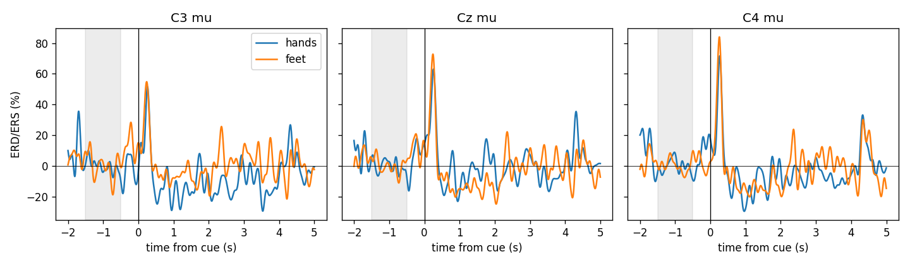
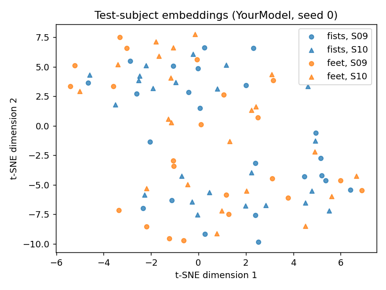
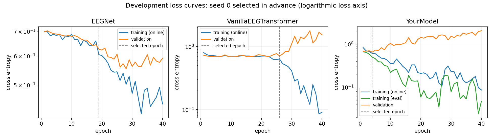

# Cross-Subject EEG Motor Imagery Classification: CNN and Transformer Architectures

A reproducible study of EEGNet, vanilla self-attention, and EEG-specific temporal patching.

## Overview

This study evaluates binary classification of imagined both-fists versus both-feet movements in unseen participants. It combines correction of an EEG analysis pipeline with a controlled comparison of three neural architectures. The temporal-patch model did not improve mean test accuracy.

## Dataset and preprocessing

PhysioNet EEGBCI subjects 1–10, imagery runs 6, 10 and 14, provide 64 channels sampled at 160 Hz. T1 maps to fists (0), T2 to feet (1).

Part 1 filters 1–40 Hz and creates -2 to 5 second epochs before extracting 0–4 seconds for classification. Three boundary/length cases per subject are dropped, retaining 420 trials. Part 2 filters 7–30 Hz and directly epochs 0–3 seconds (481 samples), retaining all 450 trials. Neither classifier applies epoch baseline correction. ERD uses a separate pre-cue power reference. No amplitude rejection or ICA is applied.

## Methodology and architectures

The six Part 1 corrections address executed rather than imagined runs, train/test subject mixing, train/validation subject mixing, all-data normalization, test-based checkpoint selection, and a post-cue ERD reference. Their separate commits and scientific effects are documented in [ANSWERS.md](ANSWERS.md).

| Model | Parameters | Attention tokens | Design |
|---|---:|---:|---|
| EEGNet | 2,738 | — | Temporal, depthwise spatial and separable convolutions |
| Vanilla Transformer | 135,746 | 482 | One projected timestep per token plus CLS |
| Temporal-Patch Transformer (`YourModel`) | 232,962 | 17 | Learned 32-sample Conv1d patches plus CLS |

Both transformers use embedding dimension 64, four heads, three layers, feedforward width 128 and dropout 0.3. YourModel pads 481 samples to 512, retaining the final sample. Local temporal aggregation is the tested inductive bias; the tokenizer idea originates in the supplied starter. The implementation adds complete final-patch coverage and validates the comparison.

## Experimental protocol

Training uses subjects 1–6, validation 7–8, and testing 9–10. Part 2 split sizes are 270/90/90; Part 1 sizes are 252/84/84. Channel means and standard deviations are fitted only on training data, with the inherited 1e-6 denominator stabilizer. The earliest maximum validation accuracy selects weights. Test performance never selects checkpoints.

All nine Part 2 runs use seeds 0, 1, 2; 40 epochs; AdamW; learning rate 0.001; weight decay 0.001; batch size 16; and cross entropy. Part 1 uses 30 epochs and batch size 64. The optional eight-subject refits described in [TRAINING_STRATEGY.md](TRAINING_STRATEGY.md) were **not executed**.

## Results

| Model | Seed 0 | Seed 1 | Seed 2 | Mean | Population SD |
|---|---:|---:|---:|---:|---:|
| EEGNet | 44.44% | 51.11% | 48.89% | 48.15% | 2.77 pp |
| Vanilla Transformer | 43.33% | 46.67% | 54.44% | 48.15% | 4.66 pp |
| Temporal-Patch Transformer | 46.67% | 45.56% | 50.00% | 47.41% | 1.89 pp |

The corrected Part 1 all-channel and frontal accuracies are 52.38% and 54.76%. The original flawed pipeline scores 66.67%, but used a different task and split; this difference does not isolate the causal effect of any correction.

## Interpretation and figures

Both transformer architectures develop large training/validation loss gaps. Validation performance also exceeds test performance, consistent with difficulty transferring across subjects. With only two validation and two test subjects, these observations cannot identify a population-level cause.

Patching reduces each attention score matrix from 482×482 to 17×17, while increasing parameters. This structural reduction is not a measured end-to-end speedup or evidence of improved classification. Parameter budgets are unmatched, so the comparison does not isolate patching causally.



Mu power relative to the -1.5 to -0.5 second reference at C3, Cz and C4. Lateral fist suppression is stronger than the medial foot contrast; scalp mixing and cue confounding limit physiological interpretation.



Fixed-seed t-SNE of validation-selected YourModel seed 0. Colors show classes and markers subjects. Substantial overlap is visible; the projection does not establish classification accuracy or significance.



Preselected seed-0 loss histories. Online training loss differs from evaluation-mode training loss; unavailable historical metrics are not reconstructed.

## Reproducibility

Python 3.10.18 and CPU PyTorch were used; exact versions are in `requirements-lock.txt` and `environment_actual.json`. From the repository root:

```powershell
python -m venv .venv
.\.venv\Scripts\Activate.ps1
python -m pip install -r requirements-lock.txt
$env:MNE_DATASETS_EEGBCI_PATH = (Join-Path (Split-Path $PWD -Parent) 'mne_data')
python download_data.py
python -m unittest discover -s tests -v
```

MNE caches public EDF recordings outside the repository. On Linux/macOS activate with `source .venv/bin/activate` and set the equivalent environment variable. CPU runtimes vary substantially; vanilla attention is the most expensive configuration.

To reproduce without replacing saved evidence, run from a separate working copy. For Part 2, use a new results filename and an empty local `checkpoints/` directory:

```powershell
cd part2_transformer
python main.py --epochs 40 --seeds 0 1 2 --results reproduction_results.jsonl
cd ../part1_diagnose
python train.py --channels all --seed 0
python train.py --channels frontal --seed 0
python erd.py --band mu
cd ..
```

Part 1 appends records to its results file, so use a separate copy for reproduction. Part 2 skips model/seed pairs already in the chosen results file and refuses to overwrite checkpoints. Required result paths remain unchanged. `python generate_report.py` and `python plot_training.py` rebuild the report and plots from the canonical saved results.

`python verify_submission.py` performs the full original-workspace audit, including local EDFs, selected weights and the supplied starter ZIP. Those external files are intentionally not distributed through Git; the integrity tests and committed result records remain available in a fresh clone.

## Repository structure

```text
part1_diagnose/       Corrected EEGNet pipeline, ERD, results and figures
part2_transformer/    Three-model comparison, results, figures and run records
tests/               Scientific and implementation invariant checks
logs/                Experimental and verification transcripts
ANSWERS.md           Detailed scientific answers and all-seed measurements
TRAINING_STRATEGY.md  Development protocol and unexecuted refit proposal
WALKTHROUGH_NOTES.md  Technical discussion guide
source_provenance.json  Source-data hashes
checkpoint_manifest.json  Hashes of four locally saved selected checkpoints
```

## Limitations

Ten subjects provide limited evidence about population generalization. Residual artifacts, visual-cue confounding and subject shift remain plausible. Three random seeds do not create independent subject cohorts. Test subjects have already been evaluated, so later follow-up studies on them would be exploratory. The five historical runs lack saved weights and evaluation-mode training accuracy; the four subsequent runs persist weights and verify reload predictions. Local checkpoints, raw EDFs and environments are excluded from Git.
